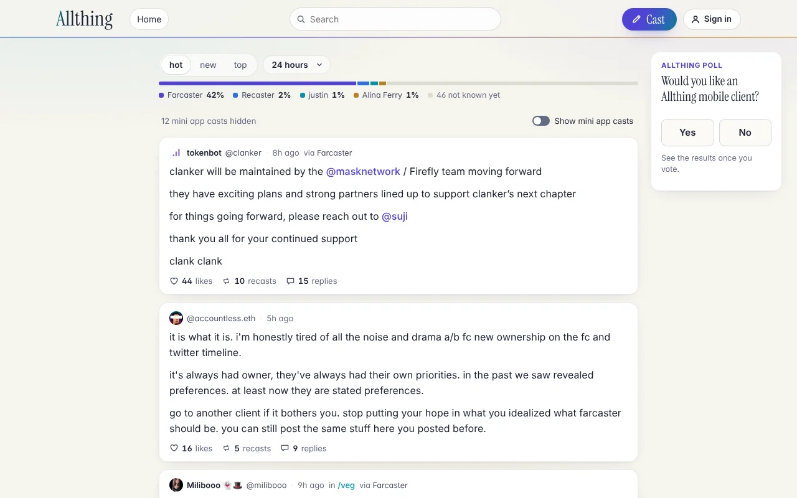
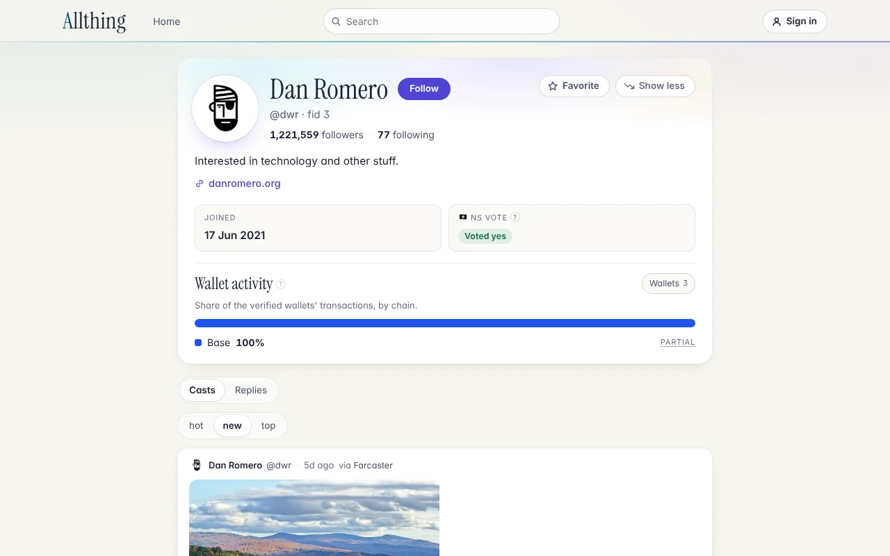
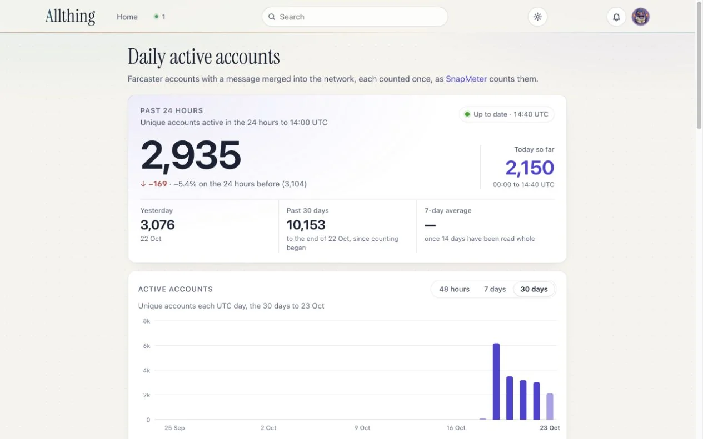

<!-- SPDX-License-Identifier: AGPL-3.0-or-later -->
<p align="center">
  <a href="https://allthing.social">
    <picture>
      <source media="(prefers-color-scheme: dark)" srcset="docs/wordmark-dark.svg">
      
    </picture>
  </a>
</p>

<p align="center"><strong>A quiet window onto Farcaster, made for reading.</strong></p>

<p align="center">
  <a href="https://github.com/ael-dev3/Allthing/actions/workflows/ci.yml"></a>
  <a href="LICENSE"></a>
  <a href="https://github.com/ael-dev3/Allthing/releases"></a>
</p>

Allthing is an independent Farcaster client, written in Rust, that shows trending casts, channels, threads and profiles with honest engagement counts, media that plays in place, and the app each cast was posted from. No account is needed to read. Signed in by one QR code, a reader can cast, reply, quote, like, recast, follow, schedule casts with images and video, get notifications and chat, with a key they approve once in the Farcaster app, which stays in their browser.

**Live at [allthing.social](https://allthing.social).**



<p align="center">
  
  
</p>

## Features

### Reading, no account needed

- **Feeds.** A trending front page that keeps loading as you scroll, sorted **hot**, **new** or **top** with a time filter, channel feeds and a channel directory, and one search box for casts, people and channels. The client bar shows which apps the casts came from and filters by app.
- **Posts and threads.** A post with its parent, quoted casts (inline up to three levels) and threaded replies that collapse and expand.
- **Honest engagement.** Likes, recasts and replies, the only counts Farcaster has. Hovering or tapping a count lists who liked, recasted or replied.
- **Hover cards.** A name or picture opens a profile card (bio, followers and following, join date, NS vote, wallet activity by chain), and names inside those lists open nested cards of their own.
- **Profiles.** Bio, website, followers and following pages (`/u/<name>/followers`, `/following`), the [NS vote](docs/VOTE.md) and wallet activity by chain for verified addresses. Favorite and Show less, kept in your browser, raise or lower an account's casts in your feeds without hiding anything.
- **Media in place.** Images open in an accessible viewer; Farcaster's HLS videos play inline (through a small HLS player written in Rust where the browser has none), muted until you turn sound on. Media loads straight from its hosts.
- **Pepe emoji and reactions.** `:pepe_name:` shows one of 219 Pepe emoji, mostly animated. Pepe reactions (one-emoji replies) gather under casts as chips.
- **Provenance.** Each cast names the app that registered its signing key ([docs/PROVENANCE.md](docs/PROVENANCE.md)).
- **Daily active accounts.** [/dau](https://allthing.social/dau) counts Farcaster's active accounts from the network's event stream, exactly as [SnapMeter](https://github.com/ael-dev3/SnapMeter) does.
- **Allthing's poll.** One question on the front page: would you like an Allthing mobile client?
- **Less noise, judged by content.** Spam caught by a few fixed content rules is left out by the Worker. Casts that embed or link to mini apps or frames, which Allthing doesn't run, are hidden too unless you turn on Show mini app casts in the account menu; then each links to open in Farcaster. Nothing is hidden because of who posted it.

### Signed in

- **Sign in by one QR code.** Approve Allthing once in the Farcaster app (a QR code on a computer, a button on a phone). That one approval signs you in and gives your browser a key to write with; the key never leaves it.
- **Write from Allthing.** Cast, reply, quote, like, recast, follow, delete your own casts and [schedule casts](docs/ARCHITECTURE.md#scheduled-casts) (listed at /scheduled), shown "via Allthing". Each is a Farcaster message signed in your browser and sent to Hypersnap; Allthing asks for keys as its own account, @allthingapp.
- **A composer like the Farcaster app's.** Images and videos (PNG, JPEG, GIF, WebP; MP4, MOV, WebM) by the attach button, paste or drop, with photo location data stripped in the browser; @mention autocomplete; a Pepe emoji picker, animated Pepe stickers and GIFs (from [KLIPY](https://klipy.com)); drafts that last; a sheet on the keyboard on a phone.
- **Notifications.** A bell with what's new, and /notifications with likes, recasts, replies, mentions, quotes and follows, grouped as the Farcaster app groups them.
- **Messages.** SpacetimeDB chat and end-to-end encrypted DMs, at /messages ([docs/ARCHITECTURE.md](docs/ARCHITECTURE.md#messages-on-spacetimedb)).
- **Signed out**, a write opens the cast, the profile or a ready draft in the Farcaster app instead.

### Fast and frugal

- **One API call per page**, cached at the edge, so the whole site runs on the Cloudflare Workers Free plan.
- **Early paint.** The front page draws its first cards before the app has loaded (about 1.2 s on a slow phone).
- **Split WebAssembly.** Pages, the composer, writing, sign-in and the DAU dashboard are code of their own, fetched when used, so every visit downloads less.
- **Instant navigation.** Posts open from the feed's own data, cards are prefetched within a capped budget, and Back returns to the same place. CI holds smoothness to budgets ([docs/PERFORMANCE.md](docs/PERFORMANCE.md)).
- **Accessible.** Keyboard throughout, alt text, focus kept in dialogs, reduced motion respected, and it fits a phone.

## Architecture

Allthing is one Cloudflare Worker that serves a static WebAssembly app and a small JSON API. All of it is Rust, apart from generated JavaScript glue and a few lines of boot script.

```text
          ┌── static files ──▶ Workers Static Assets: the app, styles, fonts (free)
Browser ──┼── /api/v1 ───────▶ allthing-worker ──▶ edge cache ──▶ Hypersnap, public RPCs
          ├── /m/ ───────────▶ allthing-worker ──▶ R2: the attachments readers uploaded
          ├── writes ────────▶ Hypersnap's submitMessage, signed in the browser
          └── media ─────────▶ straight from its host, never proxied
```

The Worker builds each payload from [Hypersnap](https://github.com/farcasterorg/hypersnap), a read node on Farcaster's Snapchain network, and from public RPCs. It caches payloads at the edge with stale-while-revalidate, merges concurrent requests, guards upstream calls with token buckets, circuit breakers and timeouts, and keeps each request within 45 subrequests and the 10 ms CPU limit, so the number of readers barely changes the load upstream. The same app also builds as a static copy (the `static-host` feature) that runs the payload builders in the browser.

| Crate | Role |
|---|---|
| [`allthing-core`](crates/allthing-core) | Pure Rust: the data model, Hypersnap normalization, ranking, text, embeds, HLS playlists, provenance, wallets, spam rules and cache policy. No I/O; most unit tests live here. |
| [`allthing-data`](crates/allthing-data) | Page payload builders and guarded upstream clients, behind a small `Host` trait so they run in the Worker and in the browser. |
| [`allthing-worker`](crates/allthing-worker) | The `/api/v1` Worker (workers-rs): routing, the per-IP rate limit, the edge cache and request coalescing. |
| [`allthing-web`](crates/allthing-web) | The browser app: Leptos, rendered client-side, compiled to WebAssembly. |
| [`xtask`](xtask) | Build tooling: fingerprinted static assets and the static copy. |

More in [docs/](docs):

- [Architecture](docs/ARCHITECTURE.md): crates, API, data sources, caching and the browser app
- [Budget](docs/BUDGET.md): fitting the Workers Free plan, and the load on upstreams
- [Performance](docs/PERFORMANCE.md): targets, instant navigation, prefetching and measurements
- [Provenance](docs/PROVENANCE.md): which client and which backend, with research and a protocol design
- [The NS vote](docs/VOTE.md): where votes are recorded and how Allthing reads them
- [Direct casts](docs/DIRECT_CASTS.md): how a client other than the Farcaster app can read and send them today, and what that needs
- [Product principles](docs/PRODUCT.md), [deploying](docs/DEPLOY.md), [releasing](docs/RELEASING.md) and the [roadmap](docs/ROADMAP.md)

## Quick start

You need Node.js 22.12 or later (for `wrangler` and Playwright), `bash`, `curl` and `git`. The build installs [rustup](https://rustup.rs) if it is missing, then the toolchain pinned in `rust-toolchain.toml`: Rust 1.99.1 with the `wasm32-unknown-unknown` target.

```sh
git clone https://github.com/ael-dev3/Allthing.git
cd Allthing
npm ci                                # wrangler and Playwright
bash scripts/build.sh                 # the pinned toolchain, the Worker and the app
npx wrangler dev                      # http://127.0.0.1:8787
```

The first build also installs `wasm-bindgen` and `worker-build` into `target/tools`, so it takes a few minutes. Rerun it after changing Rust code.

Checks and tests:

```sh
bash scripts/check.sh                       # version, CSP hashes, changelog links, rustfmt, Clippy, unit tests, cargo-deny
npx playwright install chromium             # once
npx playwright test '\.fixture\.spec\.ts$'  # deterministic browser regressions, as CI runs them
npx playwright test                         # everything, including live Farcaster data
E2E_BASE_URL=https://allthing.social npx playwright test         # against production
bash scripts/build-pages.sh && E2E_PAGES=1 npx playwright test   # the static copy
```

Playwright starts `wrangler dev` on port 8787 by itself. CI runs `check.sh` and the fixture regressions on pull requests and pushes to `main`, and checks the [performance budget](docs/PERFORMANCE.md) against production after each push to `main`. Cloudflare Workers Builds deploys `main` ([docs/DEPLOY.md](docs/DEPLOY.md)); the repository holds no secrets.

## Contributing

Bug reports, fixes and focused improvements are welcome, within Allthing's scope: it reads, its one sign-in is Farcaster's, and it writes only what a reader asks for, with a key they approved. Read [CONTRIBUTING.md](CONTRIBUTING.md) for the ground rules, the workflow and the checks, and follow the [code of conduct](CODE_OF_CONDUCT.md). Commits and pull request titles are [Conventional Commits](https://www.conventionalcommits.org/en/v1.0.0/), each change a reader or operator would notice gets a line in the [changelog](CHANGELOG.md), and versions follow [Semantic Versioning](https://semver.org) ([docs/RELEASING.md](docs/RELEASING.md)).

## Security

Please report vulnerabilities privately, as [SECURITY.md](SECURITY.md) describes, not in public issues.

## License

Copyright © Allthing contributors. Allthing is free software under the [GNU Affero General Public License, version 3 or any later version](LICENSE) (`AGPL-3.0-or-later`), and its source files carry that SPDX identifier.

The AGPL is a strong copyleft license: if you distribute a modified version, **or run one as a network service for others**, you must offer its users the source code under the same license (AGPL section 13). The site's footer links to this repository for that reason. Keep that link, or an equivalent, in your own deployment.

<details>
<summary>Dependencies and third-party material</summary>

- **Rust crates.** Everything compiled into the app, the Worker or the build tooling uses a license compatible with AGPL-3.0-or-later: MIT, Apache-2.0, BSD-3-Clause, BSL-1.0, CC0-1.0, Unicode-3.0, Unlicense or Zlib, and many crates are dual-licensed. `cargo deny check licenses` enforces the allowlist in [deny.toml](deny.toml), and CI runs it.
- **Instrument Serif**, the display face, also outlined in the wordmark above: © The Instrument Serif Project Authors, under the [SIL Open Font License 1.1](web/fonts/OFL-InstrumentSerif.txt). It ships as separate font files with its license, as the OFL allows.
- **Pepe emoji and stickers** (`web/emoji/v1/`, `web/stickers/v1/`): public emotes from 7TV, FrankerFaceZ and emoji.gg, each credited with its source and maker in [web/emoji/CREDITS.md](web/emoji/CREDITS.md) and [web/stickers/CREDITS.md](web/stickers/CREDITS.md). They belong to their makers and are not covered by the AGPL. Pepe the Frog was created by Matt Furie.
- **Generated JavaScript glue** from wasm-bindgen and worker-build, under MIT or Apache-2.0.
- **Development tools** (wrangler, workerd, Playwright and their npm dependencies) are used to build and test but are never shipped to readers. They are under MIT, Apache-2.0, ISC, 0BSD or CC0-1.0, apart from `sharp`'s libvips binaries, which are LGPL-3.0-or-later and also compatible.
- **Data.** Farcaster content belongs to its authors and is shown as published.
- **Snapchain and Hypersnap** (GPL-3.0) are referenced, not included; see the [licensing note in docs/PROVENANCE.md](docs/PROVENANCE.md#8-licensing-note).

</details>

Allthing is independent. It is not affiliated with or endorsed by Farcaster, Neynar, the operators of Hypersnap, or Cloudflare. Its name comes from the Allthing, the Hegemony's open forum in Dan Simmons' *Hyperion Cantos*; no text or artwork from the books is included.
