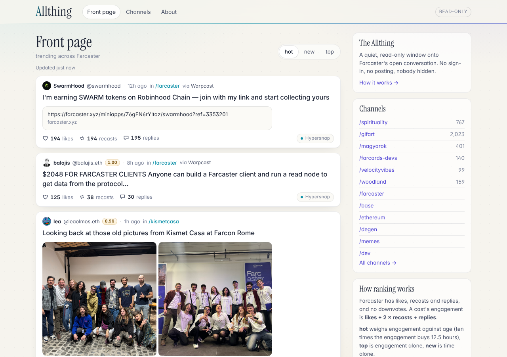
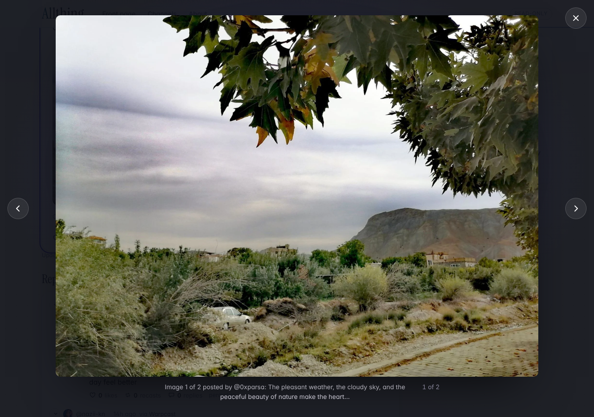
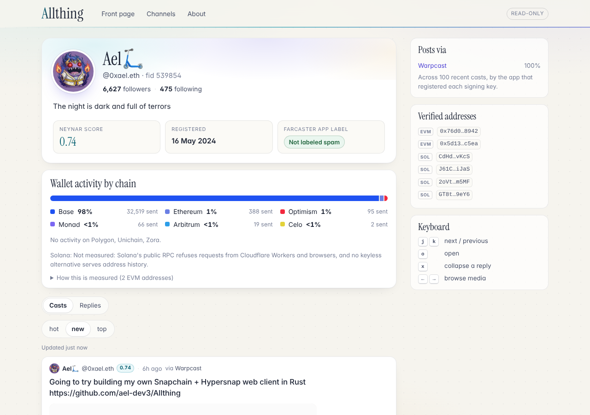
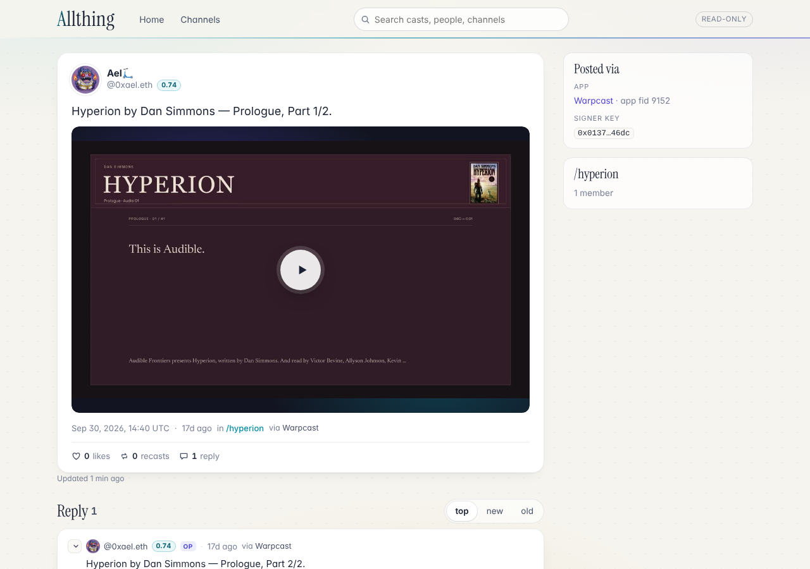

<!-- SPDX-License-Identifier: AGPL-3.0-or-later -->
# Allthing

**A quiet, read-only window onto Farcaster.** Allthing shows trending casts, channels, threads and profiles from the open Farcaster network. Its engagement counts are honest, media plays inline, and each cast shows where it came from. Nobody signs in, nothing is posted, and nobody's content is hidden.

**Live: <https://allthing.social>**, and a static copy on GitHub Pages: <https://ael-dev3.github.io/Allthing/>

The client and the API are written in Rust: a [Leptos](https://leptos.dev) app compiled to WebAssembly, and a Cloudflare Worker built with [workers-rs](https://github.com/cloudflare/workers-rs). Both run on the Workers Free plan. The name comes from the Allthing, the open forum of the Hegemony in Dan Simmons' *Hyperion Cantos*.

| Front page | A post with its media viewer |
|---|---|
|  |  |
| **A profile: score, registration, label, wallet activity** | **An inline video, with provenance** |
|  |  |

## What it does

- **Reads Farcaster without an account.** Trending front page, channels and a channel directory, posts with threaded replies that collapse and expand, and profiles. Keyboard: `j`/`k` to move, `o` to open, `x` to collapse, arrows in the media viewer.
- **Shows engagement as it is.** Farcaster has likes, recasts and replies, and no downvotes, so Allthing shows those three counts and nothing else. Ranking uses engagement (likes + 2 × recasts + replies) with time decay for **hot**, and also offers **new** and **top**. Re-sorting happens in the browser, with no extra request.
- **Plays media in place.** Images show inline and enlarge on hover. Opening a post gives an accessible media viewer: keyboard and swipe navigation, alt text, and focus that returns where it was. Farcaster's HLS videos play inline: Safari plays HLS natively, and other browsers use a small HLS player written in Rust over Media Source Extensions. Videos show a poster, preview muted on hover, and play with sound and controls on click. YouTube, Vimeo, Loom and Streamable links become click-to-load players; YouTube uses `youtube-nocookie.com`. Video bytes come straight from their host.
- **Says who people are.** Profile pictures and [Neynar scores](https://docs.neynar.com/docs/neynar-user-quality-score) appear beside names. Profiles show the bio, follower and following counts, and the registration date.
  - **Spam labels**: if the Farcaster app's [public spam labels](https://github.com/warpcast/labels) flag an account, the profile shows the label, and every cast stays visible.
  - **Wallet activity by chain**: the share of transactions sent from the account's verified EVM addresses on Base, Ethereum, Optimism, Arbitrum, Polygon, Zora, Celo, Unichain and Monad. The source is labeled. Solana is listed as not measured, with the reason.
- **Shows provenance.** Each cast names the app that registered its signing key (for example *via Warpcast*), and the backend it was read from (Hypersnap). [docs/PROVENANCE.md](docs/PROVENANCE.md) studies Snapchain and Hypersnap and proposes how a chain could record client and ingress at the protocol level.

## How it is built

```text
crates/allthing-core     Shared Rust: models, Hypersnap normalization, ranking, text, embeds,
                         HLS playlists, provenance, wallets, labels, cache policy. No I/O.
crates/allthing-data     The page payload builders and guarded upstream clients, over a small
                         Host trait, so they run in the Worker and in the browser
crates/allthing-web      The browser app (Leptos, client-side rendered, WebAssembly)
crates/allthing-worker   The /api/v1 Worker (workers-rs): routing, edge cache, rate limit
xtask                    Build tooling: fingerprinted static assets, spam-label shards
web/  style/             index.html, boot script, headers, fonts; the stylesheet
e2e/                     Playwright end-to-end tests against live data
scripts/                 build.sh (used by Cloudflare), check.sh (used by CI)
```

The browser loads static files, which are free on Workers, and then makes **one** API call per page. The Worker builds each payload from [Hypersnap](https://github.com/farcasterorg/hypersnap) and public RPCs, caches it at the edge with stale-while-revalidate, and merges concurrent requests, so the number of readers barely changes upstream load. [docs/ARCHITECTURE.md](docs/ARCHITECTURE.md) has the details and [docs/BUDGET.md](docs/BUDGET.md) has the Free plan budget.

The same app also runs on a plain static host. Built with the `static-host` feature (`bash scripts/build-pages.sh`), it runs the Worker's payload builders in the browser and reads Hypersnap and the public RPCs directly; all of them allow cross-origin reads. That copy is served from GitHub Pages under `/Allthing/`. It has no edge cache, so every reader's browser does its own reads.

The only JavaScript is generated glue (from wasm-bindgen and worker-build) and a short boot script. Compressed sizes: the app is 410 KB of WebAssembly, 10 KB of JS glue and 8 KB of CSS, and the Worker is 360 KB. Most of the app's size is the Leptos runtime and `serde_json`.

## Run it locally

You need [rustup](https://rustup.rs) and Node.js 22.12 or later. Node is used only for `wrangler` and Playwright.

```sh
npm ci
SKIP_LABELS=1 bash scripts/build.sh   # installs the pinned Rust toolchain, builds the Worker and the app
npx wrangler dev                       # http://127.0.0.1:8787
```

Drop `SKIP_LABELS=1` to also build the spam-label shards, which downloads a dataset of about 125 MB.

## Tests

```sh
bash scripts/check.sh      # rustfmt, Clippy (native and wasm32), unit tests, license audit (cargo-deny)
npx playwright test        # end to end against `wrangler dev` (started automatically) and live Farcaster data
E2E_BASE_URL=https://allthing.social npx playwright test   # the same suite against production
E2E_PAGES=1 npx playwright test                            # the static copy in dist-pages/, served like GitHub Pages
E2E_PAGES=1 E2E_BASE_URL=https://ael-dev3.github.io npx playwright test   # the live GitHub Pages copy
```

The end-to-end suite covers ranking, a single API call per page, the media viewer (keyboard, swipe, alt text, focus trap), HLS playback through the Rust player, a known video cast by @0xael.eth, plain video files, click-to-load YouTube, profiles (score, registration, wallet shares, labels, a flagged account that still shows every cast), thread collapsing, keyboard navigation, provenance and read-only behaviour. It also takes the screenshots in [docs/screenshots](docs/screenshots). GitHub Actions runs only `check.sh`, to keep CI cheap.

## Deploy

Cloudflare Workers Builds deploys every push to `main`. Settings and the first-deploy checklist are in [docs/DEPLOY.md](docs/DEPLOY.md). The repository holds no secrets.

## Documents

- [Product](docs/PRODUCT.md): what Allthing is for, and its principles
- [Architecture](docs/ARCHITECTURE.md): crates, API, data sources, caching, frontend
- [Budget](docs/BUDGET.md): fitting the Workers Free plan; upstream load
- [Deploy](docs/DEPLOY.md): Workers Builds settings, domains, rollback
- [Provenance](docs/PROVENANCE.md): client and backend provenance, research and protocol design
- [Roadmap](docs/ROADMAP.md)

Allthing is independent. It is not affiliated with or endorsed by Farcaster, Neynar, the operators of Hypersnap, or Cloudflare. No text or artwork from the *Hyperion Cantos* is included.

## License

Copyright © Allthing contributors.

Allthing is free software: you can redistribute it and/or modify it under the terms of the **GNU Affero General Public License** as published by the Free Software Foundation, either **version 3** of the License, or (at your option) **any later version**. See [LICENSE](LICENSE). Source files carry `SPDX-License-Identifier: AGPL-3.0-or-later`.

The AGPL is a strong copyleft license. A fork or modified version that you distribute, **or run as a network service for others**, must be offered to its users as source code under the same license (AGPL section 13). The site's footer links to this repository for that reason. Keep that link, or an equivalent, in your own deployment.

**Dependencies.** Every Rust crate compiled into the app, the Worker or the build tooling uses a license compatible with AGPL-3.0-or-later: MIT, Apache-2.0, BSD-3-Clause, BSL-1.0, CC0-1.0, Unicode-3.0, Unlicense or Zlib. Many crates are dual-licensed. `cargo deny check licenses` enforces this with the allowlist in [deny.toml](deny.toml), and CI runs it. **No dependency was found to be incompatible.** Other third-party material:

- **Instrument Serif** (the display face), © The Instrument Serif Project Authors, under the [SIL Open Font License 1.1](web/fonts/OFL-InstrumentSerif.txt). It is shipped as separate font files with its license, as the OFL allows.
- **Generated JavaScript glue** from wasm-bindgen and worker-build, under MIT or Apache-2.0.
- **Development tools** (wrangler, workerd, Playwright and their npm dependencies) are used to build and test but are never shipped to users. They are under MIT, Apache-2.0, ISC, 0BSD or CC0-1.0, apart from `sharp`'s libvips binary, which is LGPL-3.0-or-later and also compatible.
- **Data**: the spam labels come from [warpcast/labels](https://github.com/warpcast/labels). That repository publishes no license, so the dataset is not covered by Allthing's license. Its shards are built at deploy time and not committed, and the site credits the source. Farcaster content belongs to its authors and is displayed as published.
- **Snapchain and Hypersnap** (GPL-3.0) are referenced, not included; see the licensing note in [docs/PROVENANCE.md](docs/PROVENANCE.md).
