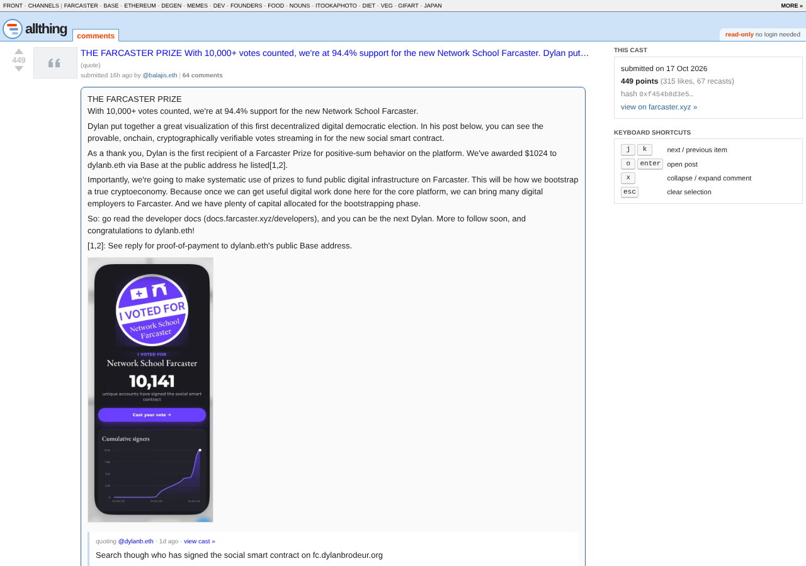
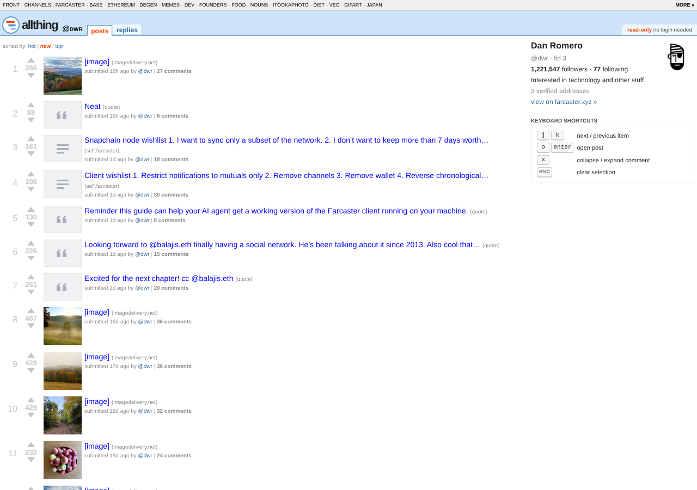

# Allthing: Next.js live prototype

**Live: https://ael-dev3.github.io/Allthing/**

A read-only, old-reddit-style Farcaster client that renders **real Farcaster data** today. It is a
Next.js (App Router, TypeScript) app reading the free, no-auth
[Hypersnap](https://github.com/farcasterorg/hypersnap) Neynar-shaped API at
`https://haatz.quilibrium.com/v2/farcaster`, behind a swappable `DataSource` interface. The same code
builds two ways: server-rendered for Node hosts, or as a static export that fetches from the browser,
which is what GitHub Pages serves.

No login, no writes, no API key, no tracking.


| Channel (`/c/farcaster`) | Post with threaded replies | Profile (`/u/dwr`) |
| --- | --- | --- |
|  |  |  |

More: [comment tree](screenshots/post-page.png), [j/k keyboard selection](screenshots/keyboard-nav.png).
The screenshots are regenerated from live data by `npm run test:e2e`.

## Pages

| Server build | Static build (GitHub Pages) | What it shows |
| --- | --- | --- |
| `/` | `/` | Front page: trending casts, sorted `hot` (default), `new` or `top` |
| `/c/<channel>` | `/c/?id=<channel>` | A channel as a subreddit, with `hot` / `new` / `top` tabs and a sidebar (members, parent URL) |
| `/p/<hash>` | `/p/?hash=<hash>` | A cast with its full reply tree; each reply collapses with `[–]`/`[+]`; comments sort `top` / `new` / `old` |
| `/u/<username>` | `/u/?name=<username>` | A profile: posts (sortable) and replies tabs, with a bio/follower sidebar. `fid:<n>` works for accounts without a username |
| `/channels` | `/channels/` | Trending channels and channel search |

A static host can only serve pages that exist at build time, so the static build moves the variable
part of the URL into the query string. Try
[/c/?id=farcaster](https://ael-dev3.github.io/Allthing/c/?id=farcaster),
[a thread](https://ael-dev3.github.io/Allthing/p/?hash=0xf454b8d3e5ee2c9252a0b7574ad4942e9ba502d2) or
[/u/?name=dwr](https://ael-dev3.github.io/Allthing/u/?name=dwr).

Listing rows follow old reddit: rank, score (likes + 2 × recasts), a 70px thumbnail of the first embed
(or a self/link/video/quote placeholder), a title made of the first ~120 characters of the cast, and the
meta line `submitted 3h ago by @user to /c/channel | 12 comments`. Verdana at 12px, a `#cee3f8` header,
blue titles that turn purple once visited.

**Keyboard:** `j`/`k` move between posts or comments, `o`/`Enter` opens the selected post (or toggles a
comment), `x` collapses a comment, `Esc` clears the selection.

## Run it

Requires Node.js 22.12 or newer.

```sh
npm install
npm run dev          # http://localhost:3000
```

Production builds:

```sh
npm run build && npm run start          # server-rendered, http://localhost:3000

ALLTHING_BASE_PATH=/Allthing npm run build:static
npm run serve:static -- /Allthing 3200  # static export, http://localhost:3200/Allthing/
```

No environment variables are needed. To switch providers, copy `.env.example` to `.env.local`:

| Variable | Meaning |
| --- | --- |
| `ALLTHING_DATA_SOURCE` | `hypersnap` (default) or `neynar` |
| `ALLTHING_API_BASE_URL` | Any base URL that serves the same API, e.g. a self-hosted Hypersnap |
| `NEYNAR_API_KEY` | Required only for `neynar`. Keep it in `.env.local` or your host's settings, never in git |

If your machine reaches the internet through an HTTPS proxy, start Node with `NODE_USE_ENV_PROXY=1`
(Node 22.21+), since Node's built-in `fetch` ignores `HTTPS_PROXY` otherwise.

## Tests

```sh
npm run check                         # ESLint, TypeScript, and Vitest unit tests (offline)
npm run build && npm run test:e2e     # Playwright against the server build, live data

ALLTHING_BASE_PATH=/Allthing npm run build:static
E2E_STATIC=1 npm run test:e2e         # the same tests against the static export

E2E_STATIC=1 E2E_BASE_URL=https://ael-dev3.github.io/Allthing/ npm run test:e2e   # the live site
```

- **Unit tests** (`tests/`, Vitest): the hot formula, sorting, pagination, title truncation, mention
  splicing, link/mention/channel tokenizing, embed classification, channel URL mapping, reply-tree
  sorting, the data source (against fixtures captured from the live Hypersnap API, with a stubbed
  `fetch`), and server-rendered `PostRow`/`CommentTree` markup.
- **End-to-end tests** (`e2e/`, Playwright): every page type renders real, current data within 3
  seconds, sort orders hold, replies collapse and expand, `j`/`k`/`o` work, nothing offers a sign-in,
  and unknown users/channels/casts show "page not found". First run on a new machine:
  `npx playwright install chromium`.

CI (`.github/workflows/ci.yml`) runs the unit tests and both end-to-end variants on pushes to `main` and
on pull requests.

## Deploy

**GitHub Pages (live):** `.github/workflows/pages.yml` runs on every push to `main`. It builds the static
export with `basePath` `/Allthing`, publishes it to the `gh-pages` branch that Pages serves, waits until
the site serves the new commit (`/build.txt`), and then runs the end-to-end tests against the live URL.
The Hypersnap API sends `Access-Control-Allow-Origin: *`, so the browser reads it directly; there is no
server and no key.

**Server-rendered (Vercel or any Node host):** import the repository on Vercel (Next.js is detected; no
settings or environment variables needed), or run `npm run build && npm run start`. The server build
makes no API calls at build time: every route is a partial prerender, a static shell with data
streamed in at request time and cached for a minute.

## How it works

```text
src/views/*               one presentational view per page, shared by both builds

server build                               static build (ALLTHING_STATIC_EXPORT=1)
src/app/**/page.tsx                        src/app/**/page.static.tsx
  reads params inside <Suspense>             renders src/client/pages.tsx: reads the query
  src/lib/data.ts: "use cache" wrappers      string, src/client/load.ts: per-key memo, fetch
           \                                  /   from the browser
            src/lib/queries.ts: page loaders (front page, channel, thread, profile)
                         |
            src/lib/datasource/
              types.ts       DataSource interface (read-only, returns normalized types)
              neynar.ts      NeynarShapedSource: Hypersnap or Neynar (same shape, different limits/key)
              normalize.ts   raw API JSON -> Cast, User, Channel, ThreadNode
              memory.ts      in-memory source for tests
```

`next.config.ts` picks the build: with `ALLTHING_STATIC_EXPORT=1` it sets `output: "export"`, a
`basePath`, and `pageExtensions: ["static.tsx"]`, so only the `*.static.tsx` route files are used.
Links go through `src/lib/links.ts`, which knows both URL schemes.

### Ranking

- **score** = likes + 2 × recasts.
- **hot** is reddit's formula: `sign(s) · log10(max(|s|, 1)) + (t − 1134028003) / 45000`, where `t` is the
  cast's Unix time. Ten times the score buys 12.5 hours of freshness.
- **top** sorts by score, **new** by time.
- Listings rank a pool of 100 casts: the trending feed on the front page, the newest 100 posts in a
  channel, a user's latest 100 casts. Pages show 25 rows each. "Top" is therefore "top of the recent
  pool", not all-time.

### Swapping the data source

Pages never call a provider directly; they go through the loaders in `src/lib/queries.ts`, which take a
`DataSource`. To add a provider (for example our own Snapchain node), implement `DataSource` in
`src/lib/datasource/` and return it from `createDataSource()` in `src/lib/datasource/index.ts`. The
static build always reads Hypersnap from the browser, since a provider that needs a key can't be called
from a public page. Each method returns normalized
types and resolves to `null` when an entity doesn't exist.

A Snapchain node serves raw protocol messages (casts by fid or parent, user data, reactions) rather
than ready-made feeds, so trending lists, reply counts, and channel metadata would need an indexer in
front of it. The interface is shaped so that indexer can sit behind it.

### Hypersnap quirks handled in the data layer

- Mentions arrive as zero-width ranges at **UTF-8 byte offsets** in text that omits them; they are
  spliced back in as `@username`. Neynar's already-inlined mentions are left alone.
- Pre-2024 channels (`/farcaster`, `/base`, `/ethereum`, `/memes`, `/degen`, `/dev`, `/founders`, `/food`,
  `/nouns`, `/purple`) post under legacy `chain://` or custom parent URLs; `src/lib/channels.ts` maps
  them. Each mapping was checked against live feeds.
- Token feeds appear as both `chain://eip155:8453/erc20:0x…` and bare `eip155:8453/erc20:0x…`; both
  spellings are queried and routed to one `/c/` page.
- Channel feeds can return up to twice the requested `limit`, interleaved from several shards, so they
  are re-sorted. `include_replies` is ignored, so replies are filtered out of listings locally.
- Hypersnap has no link-preview metadata, so link posts get a placeholder thumbnail. With Neynar,
  Open Graph images are used.
- Cloudflare Images thumbnails are requested at 140px (about 6 KB instead of about 800 KB).

## Limitations

- Read-only by design: no accounts, voting, replying, or posting. The vote arrows are decoration.
- Reply trees go as deep as the API returns them; a reply whose own replies were not returned shows "continue this thread".
- Not-found pages render inside the streamed response (or, in the static build, in the browser), so they
  return HTTP 200 rather than 404. Unknown paths on GitHub Pages do get the 404 page with a 404 status.
- Reply and comment counts come from the API's snapshot and can differ slightly between endpoints.
